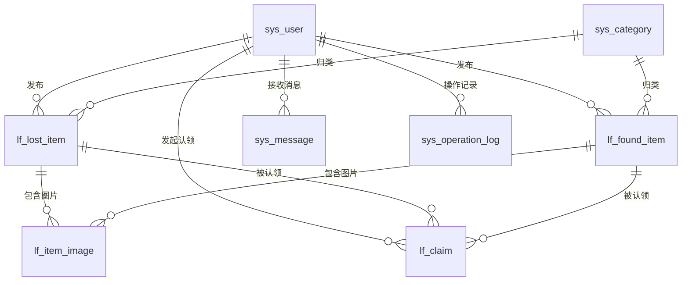

# 校园失物招领系统 — 数据库设计文档

> **版本**：v1.0  
> **日期**：2026-10-16  
> **数据库**：MySQL 8.x  
> **数据库名**：`campus_lost_found`  
> **字符集**：`utf8mb4`  
> **排序规则**：`utf8mb4_general_ci`

---

## 1. ER 关系图



---

## 2. 表结构设计

### 2.1 用户表 `sys_user`

存储所有用户信息，通过 `role` 字段区分角色。

| 字段名 | 类型 | 约束 | 说明 |
|---|---|---|---|
| `id` | BIGINT | PK, AUTO_INCREMENT | 主键 |
| `student_id` | VARCHAR(32) | UNIQUE, NOT NULL | 学号（登录凭证） |
| `username` | VARCHAR(50) | NOT NULL | 用户名 |
| `password` | VARCHAR(128) | NOT NULL | BCrypt 加密密码 |
| `nickname` | VARCHAR(50) | | 昵称 |
| `avatar` | VARCHAR(256) | | 头像 URL |
| `phone` | VARCHAR(20) | | 手机号 |
| `email` | VARCHAR(100) | | 邮箱 |
| `contact_info` | VARCHAR(100) | | QQ/微信等联系方式 |
| `role` | VARCHAR(20) | NOT NULL, DEFAULT 'STUDENT' | 角色：STUDENT / ADMIN / SUPER_ADMIN |
| `status` | TINYINT | NOT NULL, DEFAULT 1 | 状态：0-禁用 1-正常 |
| `login_fail_count` | INT | DEFAULT 0 | 登录失败次数 |
| `lock_time` | DATETIME | | 锁定到期时间 |
| `created_at` | DATETIME | NOT NULL, DEFAULT CURRENT_TIMESTAMP | 创建时间 |
| `updated_at` | DATETIME | NOT NULL, DEFAULT CURRENT_TIMESTAMP ON UPDATE | 更新时间 |
| `deleted` | TINYINT | NOT NULL, DEFAULT 0 | 逻辑删除：0-未删除 1-已删除 |

**索引**：
- `uk_student_id` UNIQUE (`student_id`)
- `idx_role` (`role`)
- `idx_status` (`status`)
- `idx_created_at` (`created_at`)

---

### 2.2 物品分类表 `sys_category`

| 字段名 | 类型 | 约束 | 说明 |
|---|---|---|---|
| `id` | INT | PK, AUTO_INCREMENT | 主键 |
| `name` | VARCHAR(50) | NOT NULL, UNIQUE | 分类名称 |
| `icon` | VARCHAR(50) | | 图标标识 |
| `sort_order` | INT | NOT NULL, DEFAULT 0 | 排序权重（越小越靠前） |
| `status` | TINYINT | NOT NULL, DEFAULT 1 | 状态：0-禁用 1-启用 |
| `created_at` | DATETIME | NOT NULL, DEFAULT CURRENT_TIMESTAMP | 创建时间 |
| `updated_at` | DATETIME | NOT NULL, DEFAULT CURRENT_TIMESTAMP ON UPDATE | 更新时间 |

---

### 2.3 失物信息表 `lf_lost_item`

| 字段名 | 类型 | 约束 | 说明 |
|---|---|---|---|
| `id` | BIGINT | PK, AUTO_INCREMENT | 主键 |
| `user_id` | BIGINT | NOT NULL, FK → sys_user.id | 发布者 |
| `category_id` | INT | NOT NULL, FK → sys_category.id | 分类 |
| `title` | VARCHAR(100) | NOT NULL | 物品名称 |
| `description` | TEXT | | 详细描述 |
| `lost_location` | VARCHAR(200) | NOT NULL | 丢失地点 |
| `lost_time` | DATE | NOT NULL | 丢失日期 |
| `contact_info` | VARCHAR(100) | | 联系方式 |
| `status` | VARCHAR(20) | NOT NULL, DEFAULT 'PENDING' | 状态 |
| `reviewer_id` | BIGINT | FK → sys_user.id | 审核人 |
| `review_comment` | VARCHAR(500) | | 审核意见 |
| `reviewed_at` | DATETIME | | 审核时间 |
| `created_at` | DATETIME | NOT NULL, DEFAULT CURRENT_TIMESTAMP | 创建时间 |
| `updated_at` | DATETIME | NOT NULL, DEFAULT CURRENT_TIMESTAMP ON UPDATE | 更新时间 |
| `deleted` | TINYINT | NOT NULL, DEFAULT 0 | 逻辑删除 |

**状态枚举**：`PENDING`、`APPROVED`、`REJECTED`、`CLAIMED`、`COMPLETED`、`CLOSED`、`EXPIRED`

**索引**：
- `idx_user_id` (`user_id`)
- `idx_category_id` (`category_id`)
- `idx_status` (`status`)
- `idx_created_at` (`created_at`)
- `idx_status_created` (`status`, `created_at`)

---

### 2.4 招领信息表 `lf_found_item`

| 字段名 | 类型 | 约束 | 说明 |
|---|---|---|---|
| `id` | BIGINT | PK, AUTO_INCREMENT | 主键 |
| `user_id` | BIGINT | NOT NULL, FK → sys_user.id | 发布者 |
| `category_id` | INT | NOT NULL, FK → sys_category.id | 分类 |
| `title` | VARCHAR(100) | NOT NULL | 物品名称 |
| `description` | TEXT | | 详细描述 |
| `found_location` | VARCHAR(200) | NOT NULL | 拾得地点 |
| `found_time` | DATE | NOT NULL | 拾得日期 |
| `storage_location` | VARCHAR(200) | | 当前存放位置 |
| `contact_info` | VARCHAR(100) | | 联系方式 |
| `status` | VARCHAR(20) | NOT NULL, DEFAULT 'PENDING' | 状态 |
| `reviewer_id` | BIGINT | FK → sys_user.id | 审核人 |
| `review_comment` | VARCHAR(500) | | 审核意见 |
| `reviewed_at` | DATETIME | | 审核时间 |
| `created_at` | DATETIME | NOT NULL, DEFAULT CURRENT_TIMESTAMP | 创建时间 |
| `updated_at` | DATETIME | NOT NULL, DEFAULT CURRENT_TIMESTAMP ON UPDATE | 更新时间 |
| `deleted` | TINYINT | NOT NULL, DEFAULT 0 | 逻辑删除 |

**状态枚举**：与 `lf_lost_item` 一致

**索引**：与 `lf_lost_item` 一致

---

### 2.5 物品图片表 `lf_item_image`

| 字段名 | 类型 | 约束 | 说明 |
|---|---|---|---|
| `id` | BIGINT | PK, AUTO_INCREMENT | 主键 |
| `item_type` | VARCHAR(10) | NOT NULL | 类型：LOST / FOUND |
| `item_id` | BIGINT | NOT NULL | 物品 ID |
| `url` | VARCHAR(512) | NOT NULL | 图片存储路径 |
| `sort_order` | INT | NOT NULL, DEFAULT 0 | 排序 |
| `created_at` | DATETIME | NOT NULL, DEFAULT CURRENT_TIMESTAMP | 创建时间 |

**索引**：
- `idx_item` (`item_type`, `item_id`)

---

### 2.6 认领申请表 `lf_claim`

| 字段名 | 类型 | 约束 | 说明 |
|---|---|---|---|
| `id` | BIGINT | PK, AUTO_INCREMENT | 主键 |
| `item_type` | VARCHAR(10) | NOT NULL | 类型：LOST / FOUND |
| `item_id` | BIGINT | NOT NULL | 物品 ID |
| `claimant_id` | BIGINT | NOT NULL, FK → sys_user.id | 认领人 |
| `description` | TEXT | NOT NULL | 认领说明 |
| `contact_info` | VARCHAR(100) | | 联系方式 |
| `status` | VARCHAR(20) | NOT NULL, DEFAULT 'PENDING' | 认领状态 |
| `owner_reviewed_at` | DATETIME | | 发布者确认时间 |
| `owner_comment` | VARCHAR(500) | | 发布者确认意见 |
| `reviewer_id` | BIGINT | FK → sys_user.id | 管理员审核人 |
| `review_comment` | VARCHAR(500) | | 管理员审核意见 |
| `reviewed_at` | DATETIME | | 管理员审核时间 |
| `created_at` | DATETIME | NOT NULL, DEFAULT CURRENT_TIMESTAMP | 创建时间 |
| `updated_at` | DATETIME | NOT NULL, DEFAULT CURRENT_TIMESTAMP ON UPDATE | 更新时间 |

**认领状态枚举**：`PENDING`、`OWNER_APPROVED`、`OWNER_REJECTED`、`APPROVED`、`REJECTED`、`CANCELLED`

**索引**：
- `idx_item` (`item_type`, `item_id`)
- `idx_claimant_id` (`claimant_id`)
- `idx_status` (`status`)
- `uk_unique_claim` UNIQUE (`item_type`, `item_id`, `claimant_id`, `status`) — 防止同一用户对同一物品重复申请

> **注意**：唯一约束需配合业务逻辑，当用户已有 PENDING 或 OWNER_APPROVED 状态的认领时，业务层阻止新申请。唯一索引作为兜底保障。

---

### 2.7 站内消息表 `sys_message`

| 字段名 | 类型 | 约束 | 说明 |
|---|---|---|---|
| `id` | BIGINT | PK, AUTO_INCREMENT | 主键 |
| `user_id` | BIGINT | NOT NULL, FK → sys_user.id | 接收者 |
| `title` | VARCHAR(200) | NOT NULL | 消息标题 |
| `content` | TEXT | NOT NULL | 消息内容 |
| `type` | VARCHAR(20) | NOT NULL | 类型：REVIEW_RESULT / CLAIM_NOTIFY / CLAIM_RESULT / SYSTEM |
| `related_id` | BIGINT | | 关联对象 ID（物品/认领） |
| `related_type` | VARCHAR(20) | | 关联类型：LOST_ITEM / FOUND_ITEM / CLAIM |
| `is_read` | TINYINT | NOT NULL, DEFAULT 0 | 已读状态：0-未读 1-已读 |
| `created_at` | DATETIME | NOT NULL, DEFAULT CURRENT_TIMESTAMP | 创建时间 |

**索引**：
- `idx_user_read` (`user_id`, `is_read`)
- `idx_user_created` (`user_id`, `created_at`)

---

### 2.8 操作日志表 `sys_operation_log`

| 字段名 | 类型 | 约束 | 说明 |
|---|---|---|---|
| `id` | BIGINT | PK, AUTO_INCREMENT | 主键 |
| `operator_id` | BIGINT | NOT NULL, FK → sys_user.id | 操作人 |
| `operation_type` | VARCHAR(50) | NOT NULL | 操作类型 |
| `target_type` | VARCHAR(50) | NOT NULL | 目标类型：LOST_ITEM / FOUND_ITEM / CLAIM / USER |
| `target_id` | BIGINT | NOT NULL | 目标 ID |
| `detail` | TEXT | | 操作详情（JSON 格式） |
| `ip_address` | VARCHAR(50) | | 操作 IP |
| `created_at` | DATETIME | NOT NULL, DEFAULT CURRENT_TIMESTAMP | 操作时间 |

**操作类型枚举**：`REVIEW_APPROVE`、`REVIEW_REJECT`、`CLAIM_OWNER_APPROVE`、`CLAIM_OWNER_REJECT`、`CLAIM_ADMIN_APPROVE`、`CLAIM_ADMIN_REJECT`、`DELETE`、`DISABLE_USER`、`ENABLE_USER`、`RESET_PASSWORD`

**索引**：
- `idx_operator` (`operator_id`)
- `idx_target` (`target_type`, `target_id`)
- `idx_created_at` (`created_at`)

---

## 3. 建表 SQL 脚本

```sql
-- ============================================
-- 校园失物招领系统 数据库初始化脚本
-- 数据库：campus_lost_found
-- 版本：v1.0
-- 日期：2026-10-16
-- ============================================

CREATE DATABASE IF NOT EXISTS `campus_lost_found`
    DEFAULT CHARACTER SET utf8mb4
    DEFAULT COLLATE utf8mb4_general_ci;

USE `campus_lost_found`;

-- -------------------------------------------
-- 1. 用户表
-- -------------------------------------------
CREATE TABLE `sys_user` (
    `id`               BIGINT       NOT NULL AUTO_INCREMENT COMMENT '主键',
    `student_id`       VARCHAR(32)  NOT NULL COMMENT '学号',
    `username`         VARCHAR(50)  NOT NULL COMMENT '用户名',
    `password`         VARCHAR(128) NOT NULL COMMENT 'BCrypt加密密码',
    `nickname`         VARCHAR(50)  DEFAULT NULL COMMENT '昵称',
    `avatar`           VARCHAR(256) DEFAULT NULL COMMENT '头像URL',
    `phone`            VARCHAR(20)  DEFAULT NULL COMMENT '手机号',
    `email`            VARCHAR(100) DEFAULT NULL COMMENT '邮箱',
    `contact_info`     VARCHAR(100) DEFAULT NULL COMMENT 'QQ/微信等联系方式',
    `role`             VARCHAR(20)  NOT NULL DEFAULT 'STUDENT' COMMENT '角色：STUDENT/ADMIN/SUPER_ADMIN',
    `status`           TINYINT      NOT NULL DEFAULT 1 COMMENT '状态：0-禁用 1-正常',
    `login_fail_count` INT          NOT NULL DEFAULT 0 COMMENT '登录失败次数',
    `lock_time`        DATETIME     DEFAULT NULL COMMENT '锁定到期时间',
    `created_at`       DATETIME     NOT NULL DEFAULT CURRENT_TIMESTAMP COMMENT '创建时间',
    `updated_at`       DATETIME     NOT NULL DEFAULT CURRENT_TIMESTAMP ON UPDATE CURRENT_TIMESTAMP COMMENT '更新时间',
    `deleted`          TINYINT      NOT NULL DEFAULT 0 COMMENT '逻辑删除：0-未删除 1-已删除',
    PRIMARY KEY (`id`),
    UNIQUE KEY `uk_student_id` (`student_id`),
    KEY `idx_role` (`role`),
    KEY `idx_status` (`status`),
    KEY `idx_created_at` (`created_at`)
) ENGINE=InnoDB DEFAULT CHARSET=utf8mb4 COLLATE=utf8mb4_general_ci COMMENT='用户表';

-- -------------------------------------------
-- 2. 物品分类表
-- -------------------------------------------
CREATE TABLE `sys_category` (
    `id`          INT          NOT NULL AUTO_INCREMENT COMMENT '主键',
    `name`        VARCHAR(50)  NOT NULL COMMENT '分类名称',
    `icon`        VARCHAR(50)  DEFAULT NULL COMMENT '图标标识',
    `sort_order`  INT          NOT NULL DEFAULT 0 COMMENT '排序权重',
    `status`      TINYINT      NOT NULL DEFAULT 1 COMMENT '状态：0-禁用 1-启用',
    `created_at`  DATETIME     NOT NULL DEFAULT CURRENT_TIMESTAMP COMMENT '创建时间',
    `updated_at`  DATETIME     NOT NULL DEFAULT CURRENT_TIMESTAMP ON UPDATE CURRENT_TIMESTAMP COMMENT '更新时间',
    PRIMARY KEY (`id`),
    UNIQUE KEY `uk_name` (`name`)
) ENGINE=InnoDB DEFAULT CHARSET=utf8mb4 COLLATE=utf8mb4_general_ci COMMENT='物品分类表';

-- -------------------------------------------
-- 3. 失物信息表
-- -------------------------------------------
CREATE TABLE `lf_lost_item` (
    `id`             BIGINT       NOT NULL AUTO_INCREMENT COMMENT '主键',
    `user_id`        BIGINT       NOT NULL COMMENT '发布者ID',
    `category_id`    INT          NOT NULL COMMENT '分类ID',
    `title`          VARCHAR(100) NOT NULL COMMENT '物品名称',
    `description`    TEXT         DEFAULT NULL COMMENT '详细描述',
    `lost_location`  VARCHAR(200) NOT NULL COMMENT '丢失地点',
    `lost_time`      DATE         NOT NULL COMMENT '丢失日期',
    `contact_info`   VARCHAR(100) DEFAULT NULL COMMENT '联系方式',
    `status`         VARCHAR(20)  NOT NULL DEFAULT 'PENDING' COMMENT '状态：PENDING/APPROVED/REJECTED/CLAIMED/COMPLETED/CLOSED/EXPIRED',
    `reviewer_id`    BIGINT       DEFAULT NULL COMMENT '审核人ID',
    `review_comment` VARCHAR(500) DEFAULT NULL COMMENT '审核意见',
    `reviewed_at`    DATETIME     DEFAULT NULL COMMENT '审核时间',
    `created_at`     DATETIME     NOT NULL DEFAULT CURRENT_TIMESTAMP COMMENT '创建时间',
    `updated_at`     DATETIME     NOT NULL DEFAULT CURRENT_TIMESTAMP ON UPDATE CURRENT_TIMESTAMP COMMENT '更新时间',
    `deleted`        TINYINT      NOT NULL DEFAULT 0 COMMENT '逻辑删除：0-未删除 1-已删除',
    PRIMARY KEY (`id`),
    KEY `idx_user_id` (`user_id`),
    KEY `idx_category_id` (`category_id`),
    KEY `idx_status` (`status`),
    KEY `idx_created_at` (`created_at`),
    KEY `idx_status_created` (`status`, `created_at`)
) ENGINE=InnoDB DEFAULT CHARSET=utf8mb4 COLLATE=utf8mb4_general_ci COMMENT='失物信息表';

-- -------------------------------------------
-- 4. 招领信息表
-- -------------------------------------------
CREATE TABLE `lf_found_item` (
    `id`               BIGINT       NOT NULL AUTO_INCREMENT COMMENT '主键',
    `user_id`          BIGINT       NOT NULL COMMENT '发布者ID',
    `category_id`      INT          NOT NULL COMMENT '分类ID',
    `title`            VARCHAR(100) NOT NULL COMMENT '物品名称',
    `description`      TEXT         DEFAULT NULL COMMENT '详细描述',
    `found_location`   VARCHAR(200) NOT NULL COMMENT '拾得地点',
    `found_time`       DATE         NOT NULL COMMENT '拾得日期',
    `storage_location` VARCHAR(200) DEFAULT NULL COMMENT '当前存放位置',
    `contact_info`     VARCHAR(100) DEFAULT NULL COMMENT '联系方式',
    `status`           VARCHAR(20)  NOT NULL DEFAULT 'PENDING' COMMENT '状态：PENDING/APPROVED/REJECTED/CLAIMED/COMPLETED/CLOSED/EXPIRED',
    `reviewer_id`      BIGINT       DEFAULT NULL COMMENT '审核人ID',
    `review_comment`   VARCHAR(500) DEFAULT NULL COMMENT '审核意见',
    `reviewed_at`      DATETIME     DEFAULT NULL COMMENT '审核时间',
    `created_at`       DATETIME     NOT NULL DEFAULT CURRENT_TIMESTAMP COMMENT '创建时间',
    `updated_at`       DATETIME     NOT NULL DEFAULT CURRENT_TIMESTAMP ON UPDATE CURRENT_TIMESTAMP COMMENT '更新时间',
    `deleted`          TINYINT      NOT NULL DEFAULT 0 COMMENT '逻辑删除：0-未删除 1-已删除',
    PRIMARY KEY (`id`),
    KEY `idx_user_id` (`user_id`),
    KEY `idx_category_id` (`category_id`),
    KEY `idx_status` (`status`),
    KEY `idx_created_at` (`created_at`),
    KEY `idx_status_created` (`status`, `created_at`)
) ENGINE=InnoDB DEFAULT CHARSET=utf8mb4 COLLATE=utf8mb4_general_ci COMMENT='招领信息表';

-- -------------------------------------------
-- 5. 物品图片表
-- -------------------------------------------
CREATE TABLE `lf_item_image` (
    `id`          BIGINT       NOT NULL AUTO_INCREMENT COMMENT '主键',
    `item_type`   VARCHAR(10)  NOT NULL COMMENT '类型：LOST/FOUND',
    `item_id`     BIGINT       NOT NULL COMMENT '物品ID',
    `url`         VARCHAR(512) NOT NULL COMMENT '图片存储路径',
    `sort_order`  INT          NOT NULL DEFAULT 0 COMMENT '排序',
    `created_at`  DATETIME     NOT NULL DEFAULT CURRENT_TIMESTAMP COMMENT '创建时间',
    PRIMARY KEY (`id`),
    KEY `idx_item` (`item_type`, `item_id`)
) ENGINE=InnoDB DEFAULT CHARSET=utf8mb4 COLLATE=utf8mb4_general_ci COMMENT='物品图片表';

-- -------------------------------------------
-- 6. 认领申请表
-- -------------------------------------------
CREATE TABLE `lf_claim` (
    `id`                BIGINT       NOT NULL AUTO_INCREMENT COMMENT '主键',
    `item_type`         VARCHAR(10)  NOT NULL COMMENT '类型：LOST/FOUND',
    `item_id`           BIGINT       NOT NULL COMMENT '物品ID',
    `claimant_id`       BIGINT       NOT NULL COMMENT '认领人ID',
    `description`       TEXT         NOT NULL COMMENT '认领说明',
    `contact_info`      VARCHAR(100) DEFAULT NULL COMMENT '联系方式',
    `status`            VARCHAR(20)  NOT NULL DEFAULT 'PENDING' COMMENT '认领状态：PENDING/OWNER_APPROVED/OWNER_REJECTED/APPROVED/REJECTED/CANCELLED',
    `owner_reviewed_at` DATETIME     DEFAULT NULL COMMENT '发布者确认时间',
    `owner_comment`     VARCHAR(500) DEFAULT NULL COMMENT '发布者确认意见',
    `reviewer_id`       BIGINT       DEFAULT NULL COMMENT '管理员审核人ID',
    `review_comment`    VARCHAR(500) DEFAULT NULL COMMENT '管理员审核意见',
    `reviewed_at`       DATETIME     DEFAULT NULL COMMENT '管理员审核时间',
    `created_at`        DATETIME     NOT NULL DEFAULT CURRENT_TIMESTAMP COMMENT '创建时间',
    `updated_at`        DATETIME     NOT NULL DEFAULT CURRENT_TIMESTAMP ON UPDATE CURRENT_TIMESTAMP COMMENT '更新时间',
    PRIMARY KEY (`id`),
    KEY `idx_item` (`item_type`, `item_id`),
    KEY `idx_claimant_id` (`claimant_id`),
    KEY `idx_status` (`status`)
) ENGINE=InnoDB DEFAULT CHARSET=utf8mb4 COLLATE=utf8mb4_general_ci COMMENT='认领申请表';

-- -------------------------------------------
-- 7. 站内消息表
-- -------------------------------------------
CREATE TABLE `sys_message` (
    `id`            BIGINT       NOT NULL AUTO_INCREMENT COMMENT '主键',
    `user_id`       BIGINT       NOT NULL COMMENT '接收者ID',
    `title`         VARCHAR(200) NOT NULL COMMENT '消息标题',
    `content`       TEXT         NOT NULL COMMENT '消息内容',
    `type`          VARCHAR(20)  NOT NULL COMMENT '类型：REVIEW_RESULT/CLAIM_NOTIFY/CLAIM_RESULT/SYSTEM',
    `related_id`    BIGINT       DEFAULT NULL COMMENT '关联对象ID',
    `related_type`  VARCHAR(20)  DEFAULT NULL COMMENT '关联类型：LOST_ITEM/FOUND_ITEM/CLAIM',
    `is_read`       TINYINT      NOT NULL DEFAULT 0 COMMENT '已读状态：0-未读 1-已读',
    `created_at`    DATETIME     NOT NULL DEFAULT CURRENT_TIMESTAMP COMMENT '创建时间',
    PRIMARY KEY (`id`),
    KEY `idx_user_read` (`user_id`, `is_read`),
    KEY `idx_user_created` (`user_id`, `created_at`)
) ENGINE=InnoDB DEFAULT CHARSET=utf8mb4 COLLATE=utf8mb4_general_ci COMMENT='站内消息表';

-- -------------------------------------------
-- 8. 操作日志表
-- -------------------------------------------
CREATE TABLE `sys_operation_log` (
    `id`              BIGINT       NOT NULL AUTO_INCREMENT COMMENT '主键',
    `operator_id`     BIGINT       NOT NULL COMMENT '操作人ID',
    `operation_type`  VARCHAR(50)  NOT NULL COMMENT '操作类型',
    `target_type`     VARCHAR(50)  NOT NULL COMMENT '目标类型：LOST_ITEM/FOUND_ITEM/CLAIM/USER',
    `target_id`       BIGINT       NOT NULL COMMENT '目标ID',
    `detail`          TEXT         DEFAULT NULL COMMENT '操作详情（JSON格式）',
    `ip_address`      VARCHAR(50)  DEFAULT NULL COMMENT '操作IP',
    `created_at`      DATETIME     NOT NULL DEFAULT CURRENT_TIMESTAMP COMMENT '操作时间',
    PRIMARY KEY (`id`),
    KEY `idx_operator` (`operator_id`),
    KEY `idx_target` (`target_type`, `target_id`),
    KEY `idx_created_at` (`created_at`)
) ENGINE=InnoDB DEFAULT CHARSET=utf8mb4 COLLATE=utf8mb4_general_ci COMMENT='操作日志表';
```

---

## 4. 初始数据

```sql
-- ============================================
-- 初始数据插入脚本
-- ============================================

USE `campus_lost_found`;

-- -------------------------------------------
-- 超级管理员账号
-- 默认密码：admin123（BCrypt 加密）
-- -------------------------------------------
INSERT INTO `sys_user` (`student_id`, `username`, `password`, `nickname`, `role`, `status`)
VALUES ('ADMIN001', 'admin', '$2a$10$EqKZhOmGBiRMJWbSBfBJPeVGOLiBMYTBdKnLcMS1C5KDfH4bEQb0G', '超级管理员', 'SUPER_ADMIN', 1);

-- -------------------------------------------
-- 预置物品分类
-- -------------------------------------------
INSERT INTO `sys_category` (`name`, `icon`, `sort_order`, `status`) VALUES
('证件',     'id-card',    1, 1),
('电子设备', 'phone',      2, 1),
('书籍文具', 'book',       3, 1),
('衣物饰品', 'shirt',      4, 1),
('钥匙卡片', 'key',        5, 1),
('运动器材', 'football',   6, 1),
('生活用品', 'toiletries', 7, 1),
('其他',     'box',        8, 1);
```

---

## 5. 设计说明

### 5.1 命名规范

| 元素 | 规范 | 示例 |
|---|---|---|
| 表名 | 小写 + 下划线，业务表加 `lf_` 前缀，系统表加 `sys_` 前缀 | `lf_lost_item` |
| 字段名 | 小写 + 下划线 | `user_id`、`created_at` |
| 索引名 | `idx_` + 字段名，唯一索引用 `uk_` | `idx_user_id`、`uk_student_id` |

### 5.2 逻辑删除

- 涉及逻辑删除的表：`sys_user`、`lf_lost_item`、`lf_found_item`
- 使用 MyBatis-Plus `@TableLogic` 注解自动处理
- 字段 `deleted`：0 = 未删除，1 = 已删除

### 5.3 多态关联设计

`lf_item_image` 和 `lf_claim` 使用 `item_type` + `item_id` 实现多态关联：
- `item_type = 'LOST'` 关联 `lf_lost_item`
- `item_type = 'FOUND'` 关联 `lf_found_item`

这种设计避免了为 lost 和 found 分别创建图片表和认领表。

### 5.4 时间字段规范

- `created_at`：记录创建时间，数据库自动填充
- `updated_at`：记录更新时间，数据库自动更新
- 业务时间字段（`lost_time`、`found_time`）：使用 `DATE` 类型，精确到日

### 5.5 状态流转约束

状态变更在服务层通过**显式条件判断**实现，不依赖数据库触发器：

```
// 物品状态合法转换
PENDING → APPROVED | REJECTED
REJECTED → PENDING（重新提交）
APPROVED → CLAIMED | CLOSED | EXPIRED
CLAIMED → COMPLETED

// 认领状态合法转换
PENDING → OWNER_APPROVED | OWNER_REJECTED | CANCELLED | REJECTED（管理员直接拒绝）
OWNER_APPROVED → APPROVED | REJECTED
```
